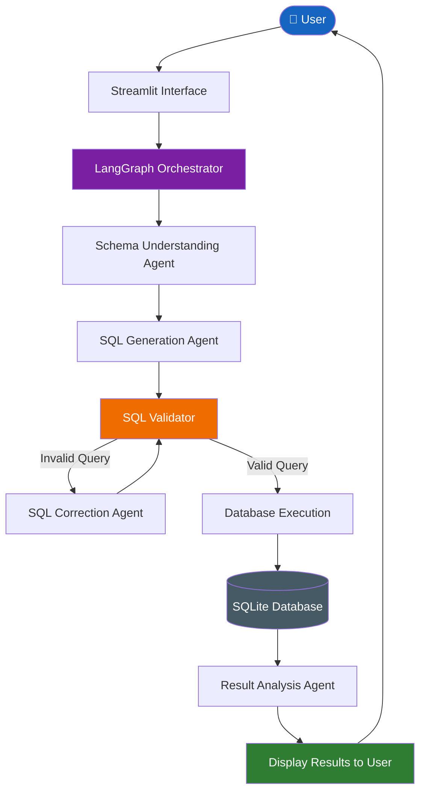

#  AI-Powered SQL Assistant

An intelligent SQL assistant that allows users to interact with databases using natural-language questions. The project uses AI agents and graph-based orchestration to understand user queries, generate SQL, validate queries, and retrieve meaningful results.

##  System Architecture

The following flowchart illustrates the complete workflow of the SQL Assistant.



##  Key Features

- **Natural Language to SQL:** Convert user questions into SQL queries.
- **Multi-Agent Architecture:** Specialized agents handle different tasks.
- **Schema Understanding:** Understand database tables, columns, and relationships.
- **SQL Validation:** Validate generated queries before execution.
- **Automatic Error Correction:** Attempt to fix invalid SQL queries.
- **Database Integration:** Execute approved queries using SQLite.
- **Result Analysis:** Present database results in an understandable format.

##  Tech Stack

| Technology | Purpose |
|---|---|
| Python | Backend development |
| Streamlit | User interface |
| LangGraph | Agent orchestration |
| LangChain | LLM integration |
| Groq API | LLM inference |
| SQLite | Database |
 
##  Project Structure

```text
AI-SQL-Assistant/
│
├── agents/               # Specialized AI agents
├── app.py                # Streamlit application
├── create_database.py    # Database initialization
├── database.py           # Database operations
├── graph.py              # LangGraph workflow
├── requirements.txt      # Project dependencies
├── school.db             # SQLite database
├── sql_validator.py      # SQL validation
├── state.py              # Shared workflow state
├── .gitignore
└── README.md
```

##  Installation & Setup

**1. Clone the repository**

```bash
git clone https://github.com/darshitarajawat/AI_POWERED_SQL_ASSISTANT.git
cd your-repository
```

**2. Create a virtual environment**

```bash
python -m venv .venv
```

Activate it:

Windows:
```bash
.venv\Scripts\activate
```

Linux / macOS:
```bash
source .venv/bin/activate
```

**3. Install dependencies**

```bash
pip install -r requirements.txt
```

**4. Configure API key**

Create a `.env` file in the root directory:

```env
GROQ_API_KEY=your_api_key
```

Use the environment variable expected by your configured LLM provider. Never upload API keys to GitHub.

**5. Initialize the database**

```bash
python create_database.py
```

Run this only if the database needs to be created or reset.

##  Run the Application

```bash
streamlit run app.py
```

Open the application at:

`http://localhost:8501`

##  How It Works

1. User submits a question in natural language.
2. The orchestrator manages the agent workflow.
3. The Schema Agent identifies relevant database information.
4. The SQL Generation Agent generates the query.
5. The SQL Validator checks the generated SQL.
6. Invalid queries are sent for correction and validation again.
7. Approved queries are executed against the database.
8. The Result Analysis Agent processes the output.
9. Results are displayed through the Streamlit interface.

##  Security

- Validate AI-generated SQL before execution.
- Prefer read-only database permissions.
- Restrict destructive SQL operations.
- Keep API keys and credentials secure.
- Apply database-level access controls.

##  Author

**Your Name**

- GitHub: [My GitHub Profile](https://github.com/darshitarajawat)
